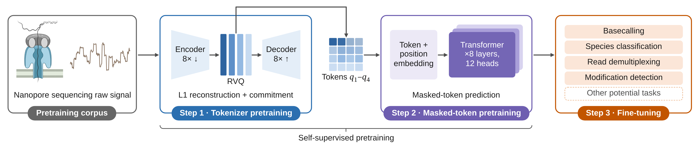

# Brieno

**A foundation model for raw nanopore signal through discrete tokenization.**

## Overview

**Brieno** is a self-supervised model that learns reusable representations of raw
nanopore signals. It first converts raw signals into discrete tokens through residual
vector quantization and then pretrains a Transformer to predict masked tokens from their
context. The pretrained Transformer can be fine-tuned with task-specific heads for
multiple downstream tasks.

With frozen or fine-tuned features, the model:

- identifies **species** without requiring reference genomes at inference time;
- achieves higher overall accuracy than Dorado in **native-barcode demultiplexing**;
- approaches Dorado’s **basecalling** performance across six genomes;
- achieves a higher read-level AUROC than Dorado’s 5mC model for **CpG methylation detection**.

## Where to go next

-   :lucide-download: **[Installation](getting-started/installation.md)**

    Install Brieno and the extras for your raw-signal format.

-   :lucide-layers: **[Downstream tasks](getting-started/tasks.md)**

    Basecalling, demultiplexing, species identification and modification calling.

-   :lucide-graduation-cap: **[Training guide](training/index.md)**

    Build your own model, from raw FAST5/POD5 to a pretrained transformer.

-   :lucide-terminal: **[CLI reference](reference/cli.md)**

    Every `brieno` command and its options.

## Name origin

*Brieno* is a shortened form of [*Brienomyrus*](https://en.wikipedia.org/wiki/Brienomyrus), a genus of weakly
electric fish that communicate through patterns of electric pulses. The name echoes Oxford
Nanopore's fish-inspired tool names, such as Bonito and Dorado, and also reflects the
model's aim to learn informative patterns in the ionic current signals recorded during
nanopore sequencing.
